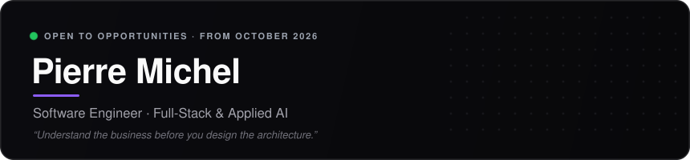
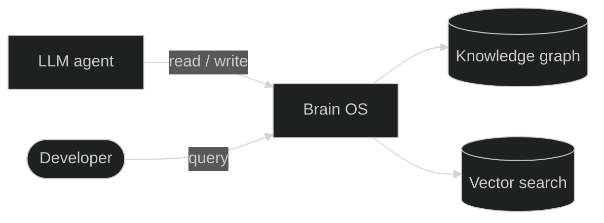
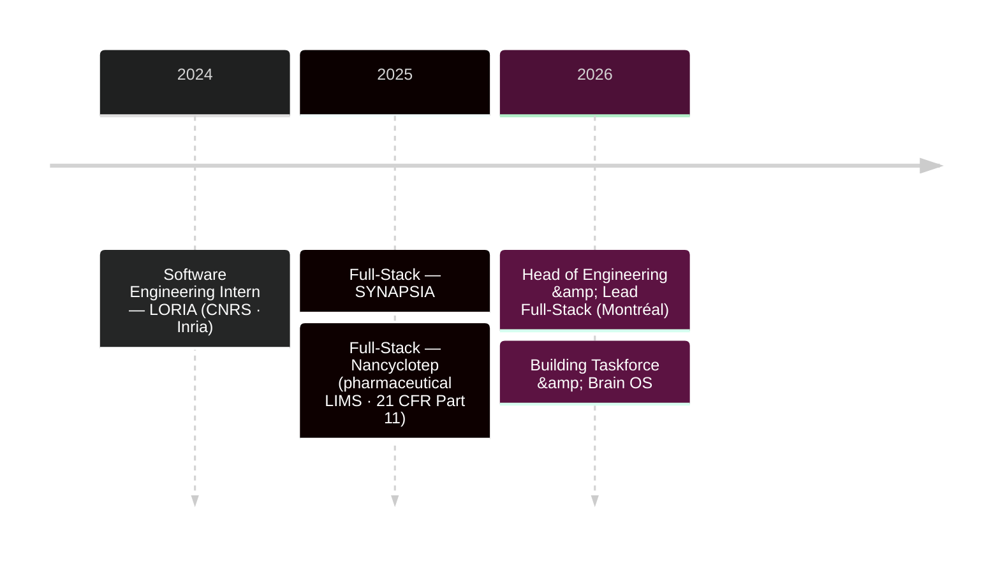

## Hey, I'm Pierre 👋

French software engineer, currently building in **Montréal** — and I like making things that actually get *used*. I care less about the framework than about what it's for, so **I start from the business, not the stack.** Give me an outcome a team actually needs, and I take it from framing to production: deciding what to build, what to automate, and where technical depth truly pays off.

One rule above the rest: **understand the business before you design the architecture.** It's what stops a system from being rebuilt six months later — and what turns engineering into something the business can *measure*.

Right now: **Head of Engineering & lead full-stack** — shipping AI-driven products that serve real processes, not demos, and building **Taskforce** & **Brain OS**.

---

## How I work

|  |  |
|---|---|
| 🎯 **Outcome first** | Automation that removes real cost, AI that serves an existing process, products that move a metric — not features for their own sake. |
| 🏗️ **Architecture that holds** | The business decides what has to be solid; my job is making sure it is — multi-tenant, secure, maintainable from day one. |
| 🤖 **AI where it earns its place** | Agentic systems and self-hosted LLMs when they solve the problem, plain code when they don't. |

---

## 🛠️ Stack

| Layer | Tooling |
|---|---|
| **Backend** | Java 21 · Spring Boot *(Clean Architecture, multi-tenant)* · PostgreSQL · REST APIs · Python · Node.js |
| **Frontend** | TypeScript · Next.js / React · React Native · TailwindCSS |
| **Applied AI** | LLMs · RAG · AI agents · MCP servers · multi-agent orchestration · embeddings · ML/DL foundations |
| **Security & Compliance** | OAuth2 / OIDC (Keycloak) · RBAC · OWASP ZAP · 21 CFR Part 11 · GAMP 5 · GDPR |
| **DevOps & Quality** | Docker · GitHub Actions · GHCR · Nginx · Git (GitFlow) · JUnit 5 · Jest · Playwright · SonarQube |

---

## 🧩 Taskforce
> *Describe the outcome — Taskforce orchestrates the execution.*

**The problem:** teams lose hours stitching work across the tools they already use — the *coordination*, not the work itself, is the real cost.

**The product:** an execution layer that sits on top of those tools. You describe *what* needs to happen; an **agentic core** works out the *how*, coordinates it across the team's tools, and remembers context through Brain OS. Multi-tenant from day one, with a **self-hosted LLM** so no customer data ever leaves the box.

**What I'm proud of:**
- **Strict multi-tenancy** enforced at every layer — isolation is a guarantee, not a convention.
- An **agentic core** that plans and executes across real tools — not a chatbot bolted on the side.
- A **self-hosted LLM** (Ollama · Qwen) — privacy by architecture, zero data exfiltration.
- **9 containerized services**, CI/CD, security-reviewed end to end.

<b>🔧 Architecture — a multi-tenant platform of 9 containerized services</b>

 

| Layer | Tech |
|---|---|
| Web | Next.js · TypeScript |
| API | Spring Boot · multi-tenant · REST / JWT |
| Auth | Keycloak · OIDC · RBAC |
| Data | PostgreSQL |
| AI | self-hosted Ollama · Qwen · multi-agent orchestration |
| Memory | Brain OS · knowledge graph + vector search |

📖 Full architecture, ADRs, API &amp; security docs → **[@taskforce-project](https://github.com/taskforce-project)**

---

## 🧠 Brain OS
> *Persistent memory for LLM agents.*

**Why it matters for the product:** most "AI memory" is just a bigger prompt — costly and forgetful. Brain OS is a structured store of **state, context, and the consequences of actions**, so an agent reasons over what actually happened. The payoff: AI that stays reliable as usage grows.

<b>🔧 How it's built</b>

 

R&amp;D on the **architecture, not the model** — the hard part of an AI system is rarely the model call. It's the context you give it, and what you do with its answer.

---

## 🧬 Where I'm heading

I want to point all of this — the engineering, the applied AI — toward something whose stakes run deeper than performance: **health and the life sciences.** My next step is **bioinformatics** — bringing AI and solid software engineering to biological and clinical data, where the reliability of the code can matter to the people who depend on it.

---

## 🧭 How I got here

🎓 **Bachelor, Full-Stack Development** — Metz Numeric School (RNCP Level 6) · heading toward a **Master in bioinformatics**

---

## 📫 Connect

