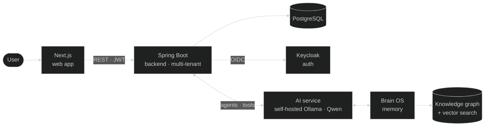
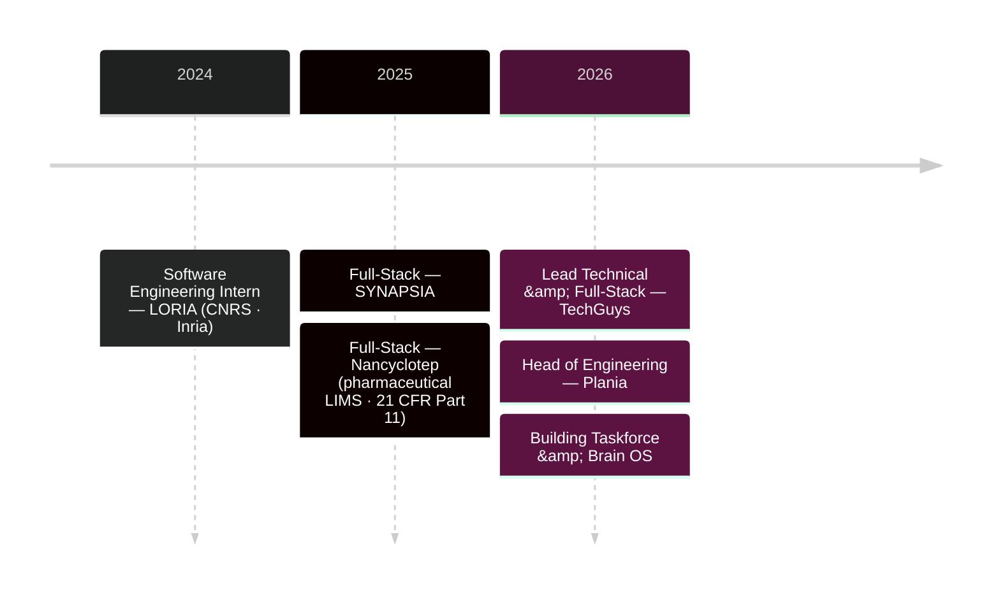

## Hey, I'm Pierre 👋

**I start from the business, not the stack.** Give me an outcome a team actually needs, and I take it from framing to production — deciding what to build, what to automate, and where technical depth truly pays off.

One rule above the rest: **understand the business before you design the architecture.** It's what stops a system from being rebuilt six months later — and what turns engineering into something the business can *measure*.

Right now: **Head of Engineering** on Plania and lead technical / full-stack developer at **TechGuys** (Montréal) — shipping AI-driven products that serve real processes, not demos.

---

## How I work

|  |  |
|---|---|
| 🎯 **Outcome first** | Automation that removes real cost, AI that serves an existing process, products that move a metric — not features for their own sake. |
| 🏗️ **Architecture that holds** | The business decides what has to be solid; my job is making sure it is — multi-tenant, secure, maintainable from day one. |
| 🤖 **AI where it earns its place** | Agentic systems and self-hosted LLMs when they solve the problem, plain code when they don't. |

---

## 🧩 Taskforce
> *Describe the outcome — Taskforce orchestrates the execution.*

**The problem it solves:** teams lose hours stitching work across the tools they already use.

**The product:** an execution layer that sits on top of those tools. You describe *what* needs to happen; an agentic core works out the *how* and coordinates it — backed by Brain OS for memory. Strict multi-tenancy and a **self-hosted LLM**, so no customer data ever leaves the box.

<b>🔧 Under the hood — a multi-tenant platform of 9 containerized services</b>

 

Strict multi-tenancy from day one, an agentic core that coordinates work across a team's tools, and a self-hosted LLM (Ollama · Qwen) — no customer data leaves the box.

📖 Full architecture, ADRs, API &amp; security docs → **[@taskforce-project](https://github.com/taskforce-project)**

---

## 🧠 Brain OS
> *Persistent memory for LLM agents.*

**Why it matters for the product:** most "AI memory" is just a bigger prompt — costly and forgetful. Brain OS is a structured store of **state, context, and the consequences of actions**, so an agent reasons over what actually happened. The payoff: AI that stays reliable as usage grows.

<b>🔧 How it's built</b>

 

R&amp;D on the **architecture, not the model** — the hard part of an AI system is rarely the model call. It's the context you give it, and what you do with its answer.

---

## 🧭 How I got here

🎓 **Bachelor, Full-Stack Development** — Metz Numeric School (RNCP Level 6)

---

## 📫 Connect

