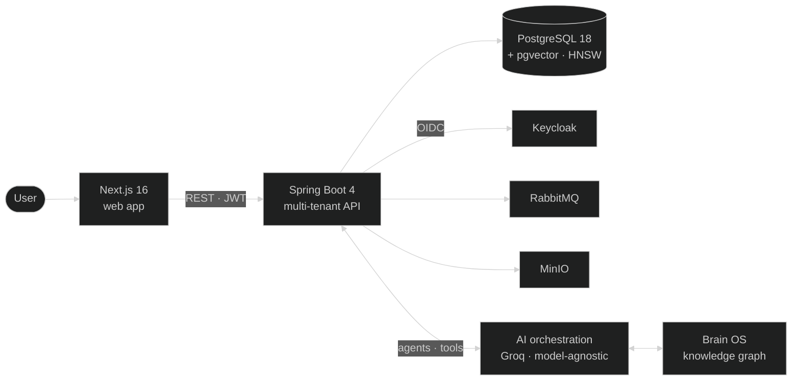
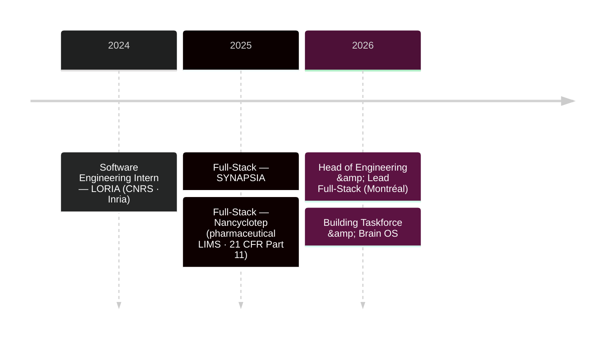

## Hey, I'm Pierre 👋

French software engineer, currently building in **Montréal** — and I like making things that actually get *used*. I care less about the framework than about what it's for, so **I start from the business, not the stack.** Give me an outcome a team actually needs, and I take it from framing to production: deciding what to build, what to automate, and where technical depth truly pays off.

One rule above the rest: **understand the business before you design the architecture.** It's what stops a system from being rebuilt six months later — and what turns engineering into something the business can *measure*.

Right now: **Head of Engineering & lead full-stack** — shipping AI-driven products that serve real processes, not demos, and building **Taskforce** & **Brain OS**.

---

## How I work

|  |  |
|---|---|
| 🎯 **Outcome first** | Automation that removes real cost, AI that serves an existing process, products that move a metric — not features for their own sake. |
| 🏗️ **Architecture that holds** | The business decides what has to be solid; my job is making sure it is — multi-tenant, secure, maintainable from day one. |
| 🤖 **AI where it earns its place** | Agentic systems and model-agnostic LLMs when they solve the problem, plain code when they don't. |

---

## 🛠️ Stack

| Area | Tooling |
|---|---|
| **Languages** | Java 21 · TypeScript · JavaScript · Python · SQL |
| **Backend** | Spring Boot *(Clean Architecture, multi-tenant)* · Node.js · REST APIs |
| **Frontend** | Next.js · React · React Native · TailwindCSS · Astro |
| **Databases** | PostgreSQL *(relational · pgvector / HNSW)* · MongoDB *(NoSQL)* |
| **Applied AI** | LLMs (Groq · Ollama) · RAG · AI agents · MCP servers · multi-agent orchestration · embeddings · ML/DL foundations |
| **Auth & Identity** | OAuth2 / OIDC · Keycloak · Clerk · RBAC |
| **DevOps & Infra** | Docker · Kubernetes · Jenkins · GitHub Actions · GHCR · Vercel · Nginx · MinIO · RabbitMQ · Linux · VMs · Git (GitFlow) |
| **Quality & Observability** | JUnit 5 · Jest · Playwright · SonarQube · PostHog · OWASP ZAP |
| **Security & Compliance** | 21 CFR Part 11 · GAMP 5 · RGPD / GDPR · **Loi 25** · **FINTRAC** |

---

## 🧩 Taskforce
> *The IDE executes. Taskforce orchestrates.*

**Today** — a multi-tenant work & project platform in the Linear / Plane family: workspaces, projects, issues, cycles, analytics, a wiki, chat, integrations, and an AI assistant.

**Where it's heading** — an **AI Delivery OS.** Instead of piloting an agent *inside* an IDE, Taskforce pilots the *whole* delivery pipeline — Idea → Product Spec → Architecture → Database → API → Implementation → Tests → Deploy — each stage a **validated checkpoint** you can't skip. You launch a *Run* (think GitHub Actions); coding agents (Claude Code, Cursor…) execute; Taskforce collects the logs, diffs, commits and tests, and gates each step. Every validated step **writes itself into Brain OS** — the documentation is generated *while* the product is built.

The bet: the best agent becomes a commodity as models improve. What nobody standardizes is **how an AI should deliver a project** — and that engine is model-agnostic (Claude, GPT, Gemini, all swappable underneath).

<b>🔧 Architecture — a multi-tenant platform of containerized services</b>

 

| Layer | Tech |
|---|---|
| Web / Landing | Next.js 16 · React 19 · TypeScript · Astro 5 |
| API | Spring Boot 4 · Java 21 · multi-tenant · REST / JWT |
| Auth | Keycloak · OIDC · RBAC |
| Data | PostgreSQL 18 · pgvector (HNSW) |
| Files / Queue | MinIO · RabbitMQ |
| AI | Groq (model-agnostic) · agent orchestration |
| Memory | Brain OS · knowledge graph + vector search |

📖 Full docs, ADRs, API &amp; the R&amp;D lab → **[@taskforce-project](https://github.com/taskforce-project)**

---

## 🧠 Brain OS — the research beneath the product
> *A world model of a software project.*

Brain OS is Taskforce's memory: the project's state as a **living knowledge graph** (PostgreSQL · pgvector · HNSW), readable in one pass by a human *or* an agent, and written to describe the **reality of the code** — not the intentions.

Underneath sits a genuine **R&D lab** — an honest attempt to formalize how a project *evolves*, under constraints that break the usual ML playbook:

- **State is the graph** — `S = G(V, E)`, nodes carrying *measurable* attributes, not decoration.
- **You never see the true state, only an estimate** — a POMDP framing; the graph knows it doesn't know everything.
- **A node is its state *and* its rhythm** (`ẋ`) — two cycles at 70%, one accelerating and one stalling, are not the same state.
- **Every axiom carries a falsifiable test** — an SQL query any dev can run to confirm or refute it. *No test → not an axiom, just a belief.*

The hard part is the setting: **one workspace (N ≈ 1), a non-replayable world, ~20 data points a year, near-zero compute.** That rules out learned world models (JEPA, MuZero, Dreamer) and forces a non-gradient, case-based approach. The question stops being *"which model"* and becomes **what you can honestly claim to know** about where a project is heading.

---

## 🧬 Where I'm heading

I want to point all of this — the engineering, the applied AI, the formal thinking — toward something whose stakes run deeper than performance: **health and the life sciences.** My next step is **bioinformatics** — bringing AI and solid software engineering to biological and clinical data, where the reliability of the code can matter to the people who depend on it.

---

## 🧭 How I got here

🎓 **Bachelor, Full-Stack Development** — Metz Numeric School (RNCP Level 6) · heading toward a **Master in bioinformatics**

---

## 📫 Connect

