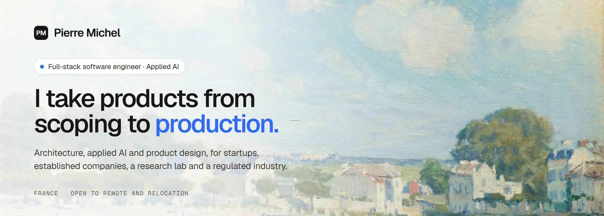
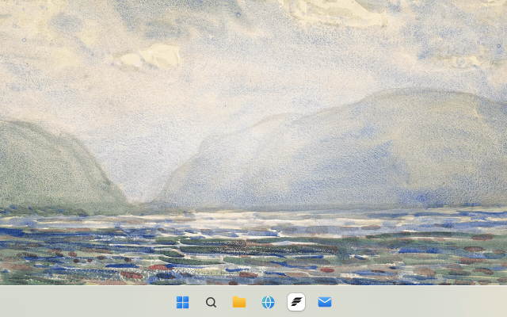

  

  <b>Full-stack software engineer moving into applied AI.</b> Architecture, LLM agents and product design, from scoping to production. 
  Based in France, open to remote work and relocation, available from October 2026.

  <a href="https://ai-portfolio-pierre-michel.vercel.app"><b>Portfolio</b></a>
  &nbsp;·&nbsp;
  <a href="https://www.linkedin.com/in/pierre-michel-work/"><b>LinkedIn</b></a>
  &nbsp;·&nbsp;
  <a href="mailto:pierre.michel.work@gmail.com"><b>Email</b></a>
  &nbsp;·&nbsp;
  <a href="https://github.com/taskforce-project/taskforce-fullstack"><b>TaskForce</b></a>

 

## About me

I am a French software engineer, and I like building things that actually get used. I care less about the framework
than about what it is for, so I start from the business, not the stack: give me an outcome a team needs, and I take
it from framing to production, deciding what to build, what to automate and where technical depth pays off.

One rule above the rest: understand the business before you design the architecture. It is what stops a system from
being rebuilt six months later, and what turns engineering into something a business can measure.

Between 2024 and 2026 I worked with eight organizations, as an employee or for clients: startups, a 13,000-user
SaaS, a research lab and a regulated pharmaceutical environment. Alongside, I build TaskForce, in the open.

## How I work

<table>
  <tr>
    <td width="33%" valign="top">
      <b>1. Scope and architecture</b> 
      We align on the outcome, the constraints and the architecture before a line of code, so the build has a spine.
    </td>
    <td width="33%" valign="top">
      <b>2. Build in the loop</b> 
      Governed increments, the right tools in the loop, human approval at each gate and a real audit trail.
    </td>
    <td width="33%" valign="top">
      <b>3. Harden and launch</b> 
      Security, observability and QA through to production, with the documentation that keeps it maintainable.
    </td>
  </tr>
</table>

Applied AI where it earns its place: agentic systems and model-agnostic LLMs when they solve the problem, plain code
when they do not. The same discipline holds for a startup MVP and for a regulated platform.

## TaskForce

<b>Delegate to AI agents. Keep the final say.</b>

  

Coding agents are fast. Working with them is still messy: context gets lost between tools, nobody sees what an agent
is doing, and its results land unchecked. TaskForce is the free, open source desktop app I build to fix that. It puts
the plan, the project's memory and the agents in one app, on your own computer, with you in charge.

- **Delegate like you assign a teammate.** Pick Claude Code or GitHub Copilot in the assignee menu, follow every file
  the agent reads and every command it runs, live on the issue, and get a pull request back.
- **Nothing ships without you.** Each run works on its own branch, inside limits set by TaskForce. Anything risky
  waits for your answer, and nothing is merged without you.
- **Git remembers what changed. TaskForce remembers why.** Brain OS keeps specs, decisions and notes as linked
  Markdown pages, and agents read them before they start.
- **Your work stays on your computer.** The AI runs on Ollama or any OpenAI-compatible key, and the app sends no usage
  data.

**From a degree project to an open source product.** TaskForce started in 2025 as a multi-tenant web platform, the
final project of my level 6 RNCP degree. In October 2026 I rebuilt it as a desktop app for Windows and Linux and opened
the whole code under the AGPL-3.0 license.

**Under the hood.** An Electron shell runs a complete local stack: a Spring Boot 4 API on Java 21, PostgreSQL 18 with
pgvector, a Next.js 16 interface, a local proxy on 127.0.0.1 behind a launch token, browser sign-in with PKCE, and a
runner that drives Claude Code. More than 1,800 backend tests and 1,100 frontend tests run in CI, with CodeQL, Semgrep
and Trivy on every pull request.

  
  
  

## Selected work

| Project | What it delivered |
| --- | --- |
| **Plania** · Head of Engineering · 2026 | A 13,000-user SaaS rebuilt from the architecture up. MRR held at $12k through the migration, 5 sales a day after the rebuild, and an AI agent adopted by 1 buyer in 10. |
| **AI sales agent** · Safex Transport · 2026 | 60% of inbound traffic handled by the agent, and 1 conversation in 4 becomes a quote request. From scoping to production in weeks. |
| **AI incident triage** · Communauto · 2026 | Cost per report from $1.93 to near zero, and about 100 hours of manual work freed every month, about $29k a year redeployed to higher-value work. |
| **Regulated fintech scoping** · Groupe Laplante · 2026 | Feasibility, architecture and compliance for 5 dealerships. |
| **Pharmaceutical LIMS** · Nancyclotep · 2025-2026 | Traceability under 21 CFR Part 11 and GAMP 5, in nuclear medicine. |

The full case studies are on my [portfolio](https://ai-portfolio-pierre-michel.vercel.app).

## Brain OS, the research beneath the product

Brain OS is TaskForce's memory: the state of a project as a living graph of linked notes, readable in one pass by a
person or by an agent, and written to describe the reality of the code rather than its intentions.

Beneath it sits a research lab, an attempt to formalize how a software project evolves, under constraints that break
the usual machine learning playbook:

- **The state is the graph.** `S = G(V, E)`, with nodes that carry measurable attributes, not decoration.
- **You never see the true state, only an estimate.** A POMDP framing: the graph knows it does not know everything.
- **A node is its state and its rhythm.** Two cycles at 70%, one accelerating and one stalling, are not the same state.
- **Every axiom carries a falsifiable test.** An SQL query anyone can run to confirm or refute it. No test, no axiom.

The hard part is the setting: one workspace, a world that cannot be replayed, about twenty data points a year and
almost no compute. That rules out learned world models and calls for a case-based approach, where the question stops
being "which model" and becomes what you can honestly claim to know about where a project is heading. The notes are
public in the [Brain OS vault](https://github.com/taskforce-project/taskforce-docs).

## Experience

| Organization | Role | Field | |
| --- | --- | --- | --- |
| TechGuys | Tech Lead | Consulting, AI | Employer |
| Plania | Head of Engineering | SaaS, AI | Employer |
| Safex Transport | Tech Lead | Freight logistics | Client |
| Communauto | Tech Lead | Automotive, mobility | Client |
| Groupe Laplante | Architect | Finance, automotive | Client |
| Nancyclotep | Full-stack developer | Nuclear medicine, pharma GxP | Employer |
| SynapsIA | Full-stack developer | Consulting, AI | Employer |
| LORIA (CNRS, Inria) | Full-stack intern | Research lab | Employer |

## Stack

  
  
  
  
  
  
  
  
  
  
  
  
  
  

| Area | Tooling |
| --- | --- |
| **Languages** | Java 21, TypeScript, JavaScript, Python, SQL |
| **Backend** | Spring Boot (Clean Architecture, multi-tenant), Node.js, REST APIs |
| **Frontend** | Next.js, React, React Native, Tailwind CSS, Astro |
| **Desktop** | Electron, with an embedded API, database and interface |
| **Databases** | PostgreSQL (relational, pgvector and HNSW), MongoDB |
| **Applied AI** | LLMs (Ollama, Groq, OpenAI-compatible APIs), RAG, AI agents, MCP servers, multi-agent orchestration, embeddings, ML and DL foundations |
| **Auth and identity** | OAuth2 and OIDC, Keycloak, passkeys, RBAC |
| **DevOps and infra** | Docker, Kubernetes, GitHub Actions, Jenkins, Vercel, Nginx, MinIO, RabbitMQ, Linux, VMs |
| **Quality and observability** | JUnit 5, Vitest, Jest, Playwright, SonarQube, CodeQL, Semgrep, Trivy, OWASP ZAP |
| **Security and compliance** | 21 CFR Part 11, GAMP 5, GDPR, Quebec's Law 25, FINTRAC |

## Education and direction

- **Bachelor in full-stack development**, level 6 RNCP, Metz Numeric School, 2025-2026. Final project: TaskForce.
- **Next: bioinformatics.** I want to point the engineering, the applied AI and the formal thinking at something whose
  stakes run deeper than performance: health and the life sciences, bringing AI and solid software to biological and
  clinical data, where the reliability of the code matters to the people who depend on it.

## Contact

  

  
  
  

